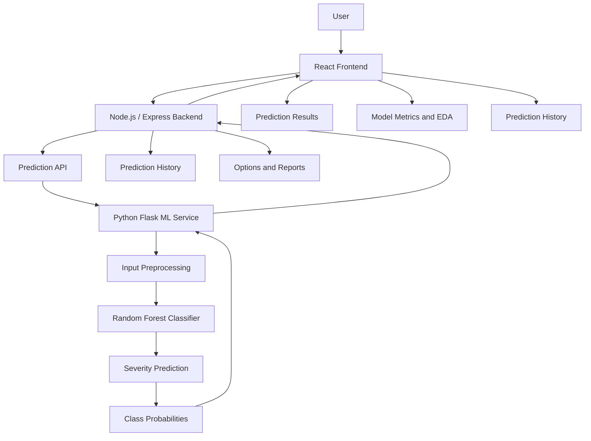

# Road Accident Severity Prediction 🚦

### A Machine Learning-Based Web Application for Road Accident Severity Analysis

Road Accident Severity Prediction is a full-stack application that uses Machine Learning to estimate the severity of a road accident based on environmental, road, traffic, and time-related conditions.

The project combines a React frontend, a Node.js backend, and a Python-based Machine Learning service to create an interactive system where users can submit accident-related information, receive a predicted severity category, and review previous predictions.

The application aims to explore how data-driven techniques can support road safety analysis and provide insights into factors associated with accident severity.

---

## 🎯 Problem Statement

Road accidents are influenced by several interconnected factors, including road conditions, weather, visibility, traffic density, and time of occurrence.

Understanding the relationship between these factors and accident severity can help in analyzing accident patterns and identifying conditions associated with more serious outcomes.

This project explores the use of Machine Learning to classify accident severity into three categories:

- **Minor**
- **Major**
- **Fatal**

The prediction is based on accident-related input features provided through the web application.

---

## ✨ Key Features

### 1. Machine Learning-Based Severity Prediction

- Predicts accident severity using a trained Random Forest classifier.
- Processes categorical and numerical accident-related features.
- Returns the predicted severity along with class probabilities.

### 2. Interactive Web Application

- React-based user interface.
- Structured input forms for accident-related parameters.
- Dedicated prediction result pages.
- Navigation between prediction, history, and model analysis sections.

### 3. Prediction History Management

- Stores prediction records with unique identifiers.
- Supports retrieving previous predictions.
- Provides functionality to edit and manage prediction records.

### 4. Model Performance Dashboard

- Displays model evaluation metrics.
- Provides access to model performance analysis.
- Includes exploratory data analysis visualizations.

### 5. Reports and Data Analysis

- Organized reports for exploring accident data.
- Dedicated pages for model metrics, exploratory analysis, and model limitations.

---

## 🏗️ System Architecture

The application follows a modular architecture with separate frontend, backend, and Machine Learning components.



### Application Components

| Component | Responsibility |
|---|---|
| React Frontend | User interface, input forms, prediction results and dashboards |
| Node.js / Express Backend | API handling, prediction requests and application data management |
| Python Flask ML Service | Input processing and Machine Learning inference |
| Random Forest Model | Accident severity classification |
| Reports | Model evaluation and exploratory analysis |

---

## 🧠 Machine Learning Approach

### Dataset

The project uses `indian_roads_dataset.csv`, containing:

| Dataset Property | Value |
|---|---:|
| Total Records | 20,000 |
| Total Columns | 24 |
| Training Records | 16,000 |
| Testing Records | 4,000 |
| Target Variable | `accident_severity` |

### Target Classes

| Class | Description | Records |
|---|---|---:|
| Minor | Minor accident severity | 11,025 |
| Major | Major accident severity | 5,988 |
| Fatal | Fatal accident severity | 2,987 |

### Input Features

The model uses a combination of categorical and numerical features.

**Categorical features:**
- City
- State
- Day of the week
- Road type
- Weather conditions
- Visibility
- Traffic density
- Accident cause

**Numerical features:**
- Latitude and longitude in the initial feature set
- Hour of occurrence
- Weekend indicator
- Number of lanes
- Traffic signal indicator
- Temperature
- Peak-hour indicator

### Data Preprocessing

The preprocessing pipeline includes:

- Separating categorical and numerical features.
- Applying One-Hot Encoding to categorical variables.
- Passing numerical features through the preprocessing pipeline.
- Using a stratified 80:20 train-test split.
- Applying class-balancing techniques during subsequent model experiments.

The target variable is `accident_severity`.

### Model Used: Random Forest Classifier

The project uses a Random Forest classification model configured with:

- 300 decision trees.
- Balanced class weights.
- Random state of 42.
- Parallel processing.

Random Forest was selected to explore the relationship between multiple accident-related variables and the resulting severity category.

---

## 📊 Model Evaluation

The latest tested model variant used oversampling and removed geographical coordinates from the feature set.

| Evaluation Metric | Result |
|---|---:|
| Accuracy | 46.52% |
| Macro Precision | 0.32 |
| Macro Recall | 0.33 |
| Macro F1-Score | 0.3137 |
| Weighted F1-Score | 0.43 |

### Important Model Limitation

The model is currently experimental and has limitations, particularly in identifying fatal accidents. The latest evaluation achieved a recall of approximately 4.86% for the fatal class.

This indicates that the model requires further improvement in class balancing, feature engineering, model selection, and evaluation before it can be considered suitable for practical road-safety applications.

**The predictions should be treated as experimental estimates, not as reliable real-world accident assessments or safety decisions.**

---

## 🖥️ Application Pages

The React application includes the following sections:

| Page | Purpose |
|---|---|
| Home | Main application interface |
| Prediction Result | Displays individual prediction results |
| Prediction History | Reviews previously generated predictions |
| Edit Prediction | Allows modification of saved prediction records |
| Model Metrics | Presents model evaluation results |
| Exploratory Data Analysis | Visualizes and explores the dataset |
| Model Limitations | Documents model limitations and considerations |

---

## 🛠️ Technology Stack

| Layer | Technologies |
|---|---|
| Frontend | React, JavaScript |
| Backend | Node.js, Express.js |
| Machine Learning Service | Python, Flask |
| Machine Learning | Scikit-learn |
| Model | Random Forest Classifier |
| Data Processing | Pandas, NumPy |
| Data Visualization | Exploratory Data Analysis tools |
| API Communication | REST APIs |

---

## 📂 Project Structure

```text
Road-accidents/
│
├── frontend/
│   └── React application
│
├── backend/
│   └── Node.js / Express application
│
├── ml-service/
│   └── Python Flask ML service
│
├── reports/
│   └── Model evaluation and analysis reports
│
├── .gitignore
└── README.md
```

---

## ⚙️ Getting Started

### Prerequisites

- Node.js and npm
- Python 3.10+
- pip

### 1. Clone the Repository

```bash
git clone https://github.com/SwathikaR-17/Road-accidents.git

cd Road-accidents
```

### 2. Set Up the Frontend

```bash
cd frontend
npm install
npm run dev
```

### 3. Set Up the Backend

Open a separate terminal:

```bash
cd backend
npm install
```

Start the Express server using the project's configured entry point.

### 4. Set Up the Machine Learning Service

Open another terminal:

```bash
cd ml-service

python -m venv venv
```

Activate the virtual environment and install the Python dependencies:

```bash
pip install -r requirements.txt
```

Start the Flask application using its configured entry point.

**Note:** The backend and ML service must both be running for prediction requests to work. Refer to the service configuration and source files for their respective startup commands and ports.

---

## 🚀 Future Improvements

- Improve prediction performance across all severity classes.
- Explore advanced ensemble learning and alternative classification algorithms.
- Improve detection of minority severity classes.
- Introduce more meaningful accident-risk indicators.
- Expand exploratory data analysis and feature engineering.
- Improve model interpretability using feature importance and explainability techniques.
- Enhance the user interface and prediction visualizations.
- Improve integration between the frontend, backend, and ML service.

---

## 👩‍💻 Author

**Swathi**

Computer Science Engineering | AI & Machine Learning

GitHub: [@SwathikaR-17](https://github.com/SwathikaR-17)

---

*An exploration of Machine Learning for understanding and analyzing road accident severity.*